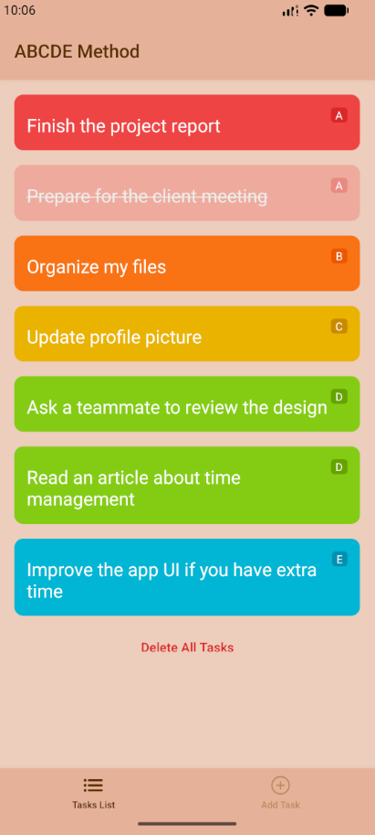
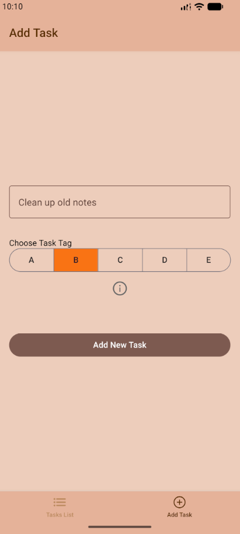

# ABCDE Method - mobile app

This is a mobile task management app built around the **ABCDE priority method**. It helps users organize tasks by importance, mark them as done, add new tasks, save them locally in AsyncStorage, and delete tasks when they are no longer needed.

The app also introduces a simple **ABCDE note assignment system**, where every task gets a priority label:

 <ol type="A">
  <li>Most important tasks that must be done today</li>
  <li>Important tasks, but not as urgent as A</li>
  <li>Low-priority tasks</li>
  <li>Tasks that can be delegated</li>
  <li>Tasks that can be done only after everything else is finished</li>
</ol>

<p align="center">
  
  
</p>

## ⚙️ Technologies

[](https://skillicons.dev)

## ⭐ Features

- Marking tasks as done
- Adding tasks
- Saving tasks in async storage
- Deleting tasks
- Organize tasks using the ABCDE method
- Use a simple ABCDE note assignment system for task prioritization

## 🚦 Get Started

1. Install dependencies

   ```bash
   npm install
   ```

2. Start the app

   ```bash
   npx expo start
   ```

## 🔎 See Also

- [My Website](https://pj-portfolio-cv.vercel.app)
- [My GitHub profile](https://github.com/OKE225)
